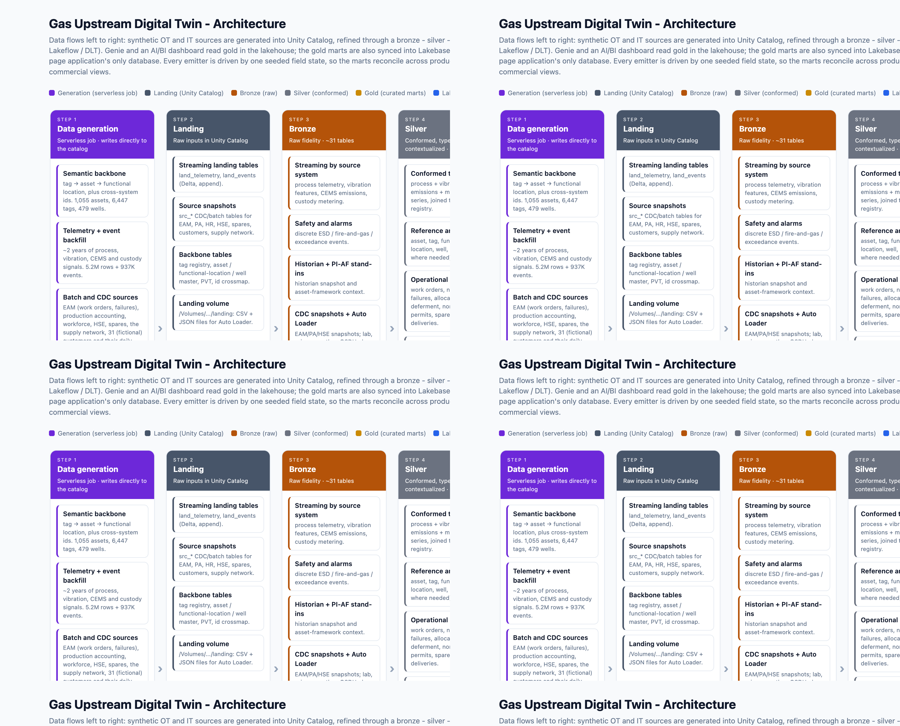

# Gas Upstream Digital Twin

A complete, self-contained digital twin for an upstream gas field, deployable to any Databricks
workspace with a single command. It generates about two years of realistic synthetic OT and IT data,
refines it through a bronze to silver to gold medallion, lands the gold marts in Lakebase (Postgres) for
a fast single-page application, and serves a curated Genie space and an AI/BI dashboard over gold.

Starting from a raw computer (macOS, Linux or Windows), an internet connection and a Databricks
workspace where you have **workspace-admin** rights, you run one command and get a running app. There
is nothing to pre-create and nothing to configure beyond pointing it at your workspace.

---

## Contents

- [Architecture](#architecture)
- [The medallion in detail](#the-medallion-in-detail)
- [Application features](#application-features)
- [Deploy](#deploy)
- [Requirements and prerequisites](#requirements-and-prerequisites)
- [After deployment: what to open](#after-deployment-what-to-open)
- [Redeploying](#redeploying)
- [Project layout](#project-layout)
- [Troubleshooting](#troubleshooting)
- [Cleanup](#cleanup)

---

## Architecture

Data flows left to right: synthetic sources are generated into Unity Catalog, refined through the
medallion on serverless Lakeflow, and served to Genie and the dashboard from gold, and to the app from
Lakebase (the gold marts synced into Postgres). Every emitter is
driven by one seeded field state, so the marts reconcile across production, reliability, emissions and
commercial views.



The one join key that ties everything together is the **tag id** (for example CPF002-CMP-AT-1018),
decoded as AREA-SYSTEM-CLASS-NNNN. It resolves through the semantic backbone to its asset, functional
location, live value and its ids in every other system (PI historian, EAM, OSDU, P&ID). The app's
**Asset Explorer** demonstrates this resolution live.

### Architecture at a glance

- **Lakehouse:**\
  Data generation, then the medallion (bronze, silver, gold) in Unity Catalog. Genie and
  the AI/BI dashboard read **gold** here, through a SQL warehouse.
- **Lakebase:**\
  Every gold mart the app reads is synced into Postgres (schema digital_twin_app, same
  table names as gold). The app reads **only** Lakebase and writes recommendation decisions back to it;
  it has no SQL warehouse.
- **Freshness:**\
  The sync runs right after each medallion load (in the deploy) and then every 5 minutes.
  A mart whose gold has not changed is skipped, so an idle sync run is short.

### The field

A national Australian operator, onshore and offshore, in realistic proportions (all names are fictional):

- **Onshore:**\
  Queensland coal seam gas in the Surat and Bowen basins (90 well pads, 2 to 6 wells each, ESP
  dewatered), conventional gas in the Cooper-Eromanga (South Australia and Queensland), Perth (WA) and
  Amadeus (NT) basins. 118 well pads tied into 17 gathering hubs.
- **Offshore:**\
  17 wellhead platforms at the real field areas of the Carnarvon (North West Shelf), Browse,
  Bonaparte, Gippsland (Bass Strait) and Otway basins, tied into 6 offshore manifolds and trunklines
  to shore.
- **Gas plants and custody:**\
  13 gas plants at their real towns (Miles, Chinchilla, Tara, Injune, Moomba, Karratha, Barrow
  Island, Darwin, Wadeye, Longford, Port Campbell, Dongara, Mereenie), each in the basin whose gas it
  handles and carrying the units its gas needs (CSG plants only dehydrate; conventional and offshore
  plants also remove CO2 and recover NGL). 12 custody points at the real export and delivery points
  supply 31 customers (LNG buyers, retailers, power, industry and spot markets).
- **Proportions:**\
  183 sites and 479 wells. The CSG pads are most of the sites, as in reality, while a handful of
  offshore platforms carry most of the gas: about half from the Carnarvon basin, a quarter from
  Queensland CSG, a tenth from Browse and the rest from Bass Strait, Otway, Bonaparte, Perth, Cooper
  and Amadeus. Each well's rate, depth and gas composition (CO2, H2S) follow its basin.
- **Site health:**\
  About two thirds of the sites are healthy (green), a fifth need attention (amber) and about one in
  ten is critical (red). Work orders, trips and equipment wear follow each site's condition.
- **Operations:**\
  Reservoirs deplete along curves (each area at its own rate), wells swing day to day, compression
  derates on hot summer days, every gas plant has a yearly planned turnaround (its wells shut in for 3
  to 6 days) and wells trip now and then (recorded as deferment), so the trends look like a real field.

The layout lives in config/twin_config.yaml (basins, platforms, plants, custody points, customers and
the site-condition odds).

### What gets deployed

| Component | What it is |
|-----------|------------|
| **Catalog + schema** | A Unity Catalog catalog (default gas_upstream_digital_twin) and schema (digital_twin) holding every table, mart and the landing volume. |
| **Data generator** | A serverless job that builds the semantic backbone and backfills telemetry, events, work orders, lab assays, weather, prices, spares and more. |
| **Medallion pipeline** | A serverless Lakeflow (DLT) pipeline: bronze (raw) to silver (conformed) to gold (curated marts). |
| **The app** | "Databricks Asset Atlas": a FastAPI + single-page application: Command Centre, reservoir-to-customer impact analysis (with PDF export), Field Map, site views, the Gas flow chain, Analytics and Commercial & Finance tabs, a human-in-the-loop recommendation inbox, an asset explorer, and a link to Genie. |
| **Genie space** | "Asset Intelligence Genie": a curated natural-language analytics space over the gold marts only, opened in Databricks One from the app's lamp icon. |
| **AI/BI dashboard** | A published dashboard, "Gas Upstream Digital Twin", with five pages: Field Command Centre, Wells & Lift, Compression Health, Deferment & Emissions, Custody & UAF. |
| **Lakebase** | A Lakebase Autoscaling project (0.5 to 4 CU, scales to zero after 5 idle minutes): the app's **only** database. Every gold mart the app reads is a Lakebase synced table (one sync pipeline), refreshed straight after the medallion and then every 5 minutes by the "Lakebase sync" job; recommendation decisions are written back to it. |

---

## The medallion in detail

Everything lands in one catalog and schema, parameterised as bundle variables. All tables and columns
carry COMMENTs.

- **Generation (the setup job):**\
  write_backbone writes the semantic backbone (tag registry, asset
  master, functional-location hierarchy, well master, PVT, id crossmap: 1,055 assets, 6,447 tags, 479
  wells). run_generator backfills land_telemetry and land_events (about 5.2M telemetry rows and
  937K events over two years). batch_sources writes the src_\* snapshot tables and the files on the
  landing volume (lab, proving, prices, weather, OSDU well/PVT, geometry, imagery, documents), plus the
  supply network (reservoir to customer) and a fictional customer book of 31 buyers with two years of
  daily custody deliveries that reconcile to metered production.

- **Landing:**\
  Streaming sources land in the Delta tables land_telemetry and land_events; the file
  sources are written to the Unity Catalog volume /Volumes/&lt;catalog&gt;/&lt;schema&gt;/landing and ingested by
  Auto Loader in bronze. The deploy creates that volume up front, since the generator writes files into
  it but cannot create the volume object itself. The semantic backbone is the join spine: every tag id
  (AREA-SYSTEM-CLASS-NNNN) resolves through it to an asset, a functional location and the matching ids
  in PI historian, EAM, OSDU and P&ID, so all downstream marts reconcile on one key.

- **Bronze (raw fidelity, about 31 tables):**\
  Streams land_telemetry split by source system (process
  telemetry, vibration features, CEMS emissions, custody metering), streams safety/alarm events,
  materialises historian and PI Asset-Framework stand-ins, snapshots the src_\* CDC tables, and uses
  Auto Loader for the volume files. Raw rows are preserved with ingest metadata.

- **Silver (conformed, typed, contextualized, about 33 tables):**\
  Cleanses and types the telemetry,
  joins it to the tag registry, applies SCD where needed on reference and master data, and conforms the
  operational records (work orders, notifications, failures, allocation, deferment, nominations,
  permits, spares, customers and deliveries, the supply network) and context (lab, weather, prices,
  proving, documents, geometry).

- **Gold (41 curated marts, the serving layer):**\
  Business marts and ML proxies the app, Genie and the
  dashboard consume: field production, well scorecard, compression health, plant KPI, asset state, tag
  latest, constraint ranking, flow assurance, custody allocation, integrity/RBI, safety alarms,
  emissions ledger, deferment, economics, commercial, weather, lab assay, work orders, notifications,
  failure history, maintenance reliability, produced water, energy efficiency, carbon compliance,
  methane LDAR, margin, spares risk, capital plan, remaining useful life, liquid-loading risk,
  production forecast, recommendations, the impact-analysis marts (supply network with flows, supply
  nodes, customer supply), and the app-serving backbone marts (tag context, asset master, functional
  locations, sites, per-asset signal series in 5-gas-day buckets, safety events). Gold is the only layer
  Genie queries, and the only layer synced to Lakebase for the app.

---

## Application features

The app ("Databricks Asset Atlas") opens on the Command Centre. The left menu has six icons
(hover one to see its name): Command Centre, Gas flow chain, Analytics, Commercial & Finance,
Recommendation Inbox and Asset Explorer. A short tour follows; the full screen-by-screen guide is in
[docs/NAVIGATION.md](docs/NAVIGATION.md).

**Command Centre and what opens from it**
- **Command Centre:**\
  The field rate, the difference from commitment, the current bottleneck, the
  value chain as five pictures (the stop under pressure is red), production against commitment, and
  tiles for deferment, carbon intensity, red assets, ESD trips and open work orders. Everything is
  clickable; anything red or amber opens the screen where its cause lives, with the cause
  highlighted (rows, bars, lines and tiles) and a banner saying why.
- **Impact analysis** (the flow icon on the top tile):\
  The whole gas path as a Sankey: reservoirs,
  well pads and offshore platforms, gathering hubs and manifolds, gas plants, compressors, custody meters and the customers the gas
  is custody-transferred to. Click any stop to highlight everything upstream that feeds it and
  everything downstream it supplies; a speech bubble lists the affected customers with the gas each
  would lose (TJ/d and % of its supply). **Download Impact Details (PDF)** exports the full upstream,
  downstream and customer tables.
- **Field Map** (the map icon on the top tile):\
  Every site across the operator's ten basins, onshore and offshore, grouped
  into "N sites" bubbles; hover a site for its details, click it to open its **Site view**.
- **Site view:**\
  The site's equipment with a tag over each asset; click an asset or its tag to slide in its full detail.
  It opens on the complete site. Onshore sites sit on an outback pad; offshore platforms and manifolds
  sit on a steel deck over a deep blue sea with boats, buoys, gulls and other platforms around them.

**Menu**
- **Gas flow chain:**\
  The five value-chain stops as tabs: Reservoirs & Wells, Gathering & Flow
  Assurance (hydrate margin), Processing / CPF (dewpoint and spec margins), Compression Health (the
  vibration-to-remaining-life story), Custody Transfer & Export (metered vs allocated, UAF).
- **Analytics:**\
  The operational and HSE reports as tabs on one line: Integrity & RBI, Safety & Alarms, Emissions,
  Carbon & Safeguard (intensity, CH4 by source and the Safeguard position in one tab), Maintenance, Lab &
  Assay, Weather (a per-site weather map), Produced Water, Fuel Gas & Energy, Methane LDAR, and Spares &
  Procurement (what to procure, lead time vs remaining life).
- **Commercial & Finance:**\
  The money reports as tabs: Deferment & Losses, Cost & Economics, Commercial & Prices,
  Molecule-to-Market Margin (netback and take-or-pay) and Capital & Decline-Aware Investment.
- **Recommendation Inbox:**\
  Prescriptive recommendations with their evidence and linked open work
  orders: accept / reject / annotate, written back and audited to Lakebase, with Undo.
- **Asset Explorer:**\
  Resolve any tag end to end on the left (decoded key, asset link,
  functional location, latest reading with its normal range, and its ids in every other system) and
  browse the physical-location tree on the right (field to basin to site to asset to tag).

**Across every screen**
- Sortable tables with an **i** on every column; table rows open a detail panel (a work-order row opens
  the work order, any other row opens that asset's detail with telemetry charts, work orders,
  notifications, failures, procurement, lab, deferment and live tags, plus **View site**).
- Every work-order id anywhere is a link to the work order.
- The Genie lamp (top right) opens **Asset Intelligence Genie** in Databricks One.
- Every screen reads Lakebase through a connection pool with concurrent queries, so single-asset lookups
  (asset detail, work orders, location tree, tag lookup) return in milliseconds. The first request after
  an idle spell wakes Lakebase from scale to zero, which takes a moment.

---

## Deploy

Clone or copy this folder onto your computer, open a terminal in it, and run the command for your OS.

**macOS / Linux**

```bash
chmod +x scripts/*.sh

# 1. Workspace only: deploys into the default catalog, gas_upstream_digital_twin
scripts/deploy.sh --host https://your-workspace.cloud.databricks.com

# 2. Workspace plus a catalog of your choice
scripts/deploy.sh --host https://your-workspace.cloud.databricks.com --catalog my_catalog
```

**Windows (PowerShell)**

```powershell
# 1. Workspace only: deploys into the default catalog, gas_upstream_digital_twin
.\scripts\deploy.ps1 -WorkspaceUrl https://your-workspace.cloud.databricks.com

# 2. Workspace plus a catalog of your choice
.\scripts\deploy.ps1 -WorkspaceUrl https://your-workspace.cloud.databricks.com -Catalog my_catalog
```

That is the whole thing. A browser window opens for you to sign in (OAuth); the script then runs end to
end and prints the app URL and catalog at the finish. Passing --host always signs you in to exactly
that workspace, so you cannot accidentally deploy to a stale cached one. If you omit the URL, the script
asks for it, so a bare scripts/deploy.sh works too (with --profile NAME instead, it reuses that
profile's existing sign-in).

**Choosing the catalog (--catalog / -Catalog):**\
The deploy uses the catalog if it already exists, and creates it if it is not there. With no --catalog it
uses gas_upstream_digital_twin. Using an existing catalog needs only USE CATALOG and CREATE SCHEMA on it;
creating a new one needs the CREATE CATALOG privilege. Either way, the project writes only to its own two
schemas in that catalog (digital_twin and digital_twin_app), so other content in it is left alone.

### Options

| macOS/Linux flag | Windows flag | Default | Meaning |
|------------------|--------------|---------|---------|
| --host URL | -WorkspaceUrl URL | prompted | Workspace URL. If omitted, the script asks for it. |
| --catalog NAME | -Catalog NAME | gas_upstream_digital_twin | Target catalog. An existing catalog is used as is (you need USE CATALOG and CREATE SCHEMA on it); otherwise it is created. |
| --schema NAME | -Schema NAME | digital_twin | Target schema. |
| --warehouse ID | -Warehouse ID | auto | Use a specific SQL warehouse instead of auto-detect/create. |
| --lakebase NAME | -Lakebase NAME | gas-upstream-twin-lakebase | Lakebase project id (created with scale to zero if it does not exist). |
| --sync-cron CRON | -SyncCron CRON | 0 0/5 \* \* \* ? | Quartz schedule for the gold-to-Lakebase re-sync (every 5 minutes). |
| --app-name NAME | -AppName NAME | gas-upstream-twin | Databricks App name (unique in the workspace). |
| --profile NAME | -Profile NAME | derived from URL | CLI auth profile. By default a per-workspace name is derived from the URL (e.g. gastwin-dbc-xxxx), so each workspace gets its own and logins never conflict. |
| --skip-data | -SkipData | off | Deploy only; do not (re)generate data. Use for code-only redeploys. |

### What happens, and how long it takes

The script runs in phases and tells you where it is. End to end is roughly **30 minutes** (a clean test run took 28), most of it
data generation, the first medallion run and the first Lakebase sync.

1. Prerequisites and CLI, then sign-in.
2. Find or create a serverless SQL warehouse (for the SQL steps, Genie and the dashboard).
3. Use the catalog if it already exists, otherwise create it; then the schema and landing volume (via
   SQL, so it works on Default Storage workspaces).
4. Create the Lakebase project (scale to zero; about a minute).
5. Deploy the bundle (pipeline, jobs, app).
6. **Generate the data** (the longest step).
7. Run the medallion pipeline (bronze to silver to gold).
8. Land the gold marts in Lakebase: create the synced tables and sync them (about 8 to 10 minutes the
   first time), seed the recommendation write-back table, grant the app, and schedule the 5-minute
   re-sync job.
9. Build the Genie space and the dashboard.
10. Start the app and wire it to Genie and Lakebase.

---

## Requirements and prerequisites

**On your computer** (the script installs what it can):

- An internet connection.
- The **Databricks CLI**. If it is missing, the script installs it (official installer on macOS/Linux,
  winget on Windows). See the [Databricks CLI install guide](https://docs.databricks.com/dev-tools/cli/install.html) to do it yourself.
- **Python 3** on macOS/Linux only (used to read JSON responses). It ships with most systems; if not,
  install the Xcode Command Line Tools (xcode-select --install) or your distro's python3 package.
  Windows needs nothing beyond the CLI.

**In the workspace** (workspace-admin satisfies these):

- Unity Catalog enabled, with permission to create a catalog, or an existing catalog you can pass in
  with --catalog (USE CATALOG and CREATE SCHEMA on it are enough).
- **Serverless compute** available (jobs, Lakeflow pipelines and SQL warehouse).
- **Databricks Apps** enabled.
- **Lakebase Autoscaling** (Lakebase projects, with synced tables) available in the workspace region.
- **Genie** available.

The one hard requirement is a catalog: either the right to create one, or an existing one you can create
schemas in. Everything else the script creates or auto-detects; there are no config files to edit.

---

## After deployment: what to open

When the script finishes it prints a summary like this:

```
  App:        https://gas-upstream-twin-xxxxxxxx.<region>.databricksapps.com
  Catalog:    gas_upstream_digital_twin.digital_twin
  Genie:      https://your-workspace.cloud.databricks.com/one/agents/<id>
  Dashboard:  open Dashboards > "Gas Upstream Digital Twin"
  Lakebase:   gas-upstream-twin-lakebase  (Postgres schema digital_twin_app; re-sync job "[...] Gas Twin - Lakebase sync")
  Warehouse:  <id>  (Genie + dashboard)
```

- **App:**\
  Open the printed URL and start at the **Command Centre**.
- **Catalog:**\
  Open **Catalog** and browse gas_upstream_digital_twin.digital_twin. The gld_\* tables
  are the curated marts; slv_\* are conformed; bronze_\* are raw. gas_upstream_digital_twin.digital_twin_app
  holds the Lakebase synced tables (the app's copy of the gold marts).
- **Lakebase:**\
  Open **Compute > Lakebase** (project gas-upstream-twin-lakebase) to see the synced
  tables and the scale-to-zero compute; the "Lakebase sync" job is under **Jobs & Pipelines**.
- **Genie:**\
  Open the printed Genie link (it opens **Asset Intelligence Genie** in Databricks One), or
  click the lamp at the top right of the app, and ask questions over the marts.
- **Dashboard:**\
  Open **Dashboards** and select "Gas Upstream Digital Twin".

Start with [docs/NAVIGATION.md](docs/NAVIGATION.md) for a guided tour of the app.

---

## Redeploying

The deploy is designed to run once per workspace against an empty catalog. To redeploy from scratch
(fresh data and resources), run a full cleanup to return the workspace to a clean state, then deploy
again:

```bash
scripts/cleanup.sh --host https://your-workspace.cloud.databricks.com --yes   # macOS/Linux
scripts/deploy.sh  --host https://your-workspace.cloud.databricks.com
```

```powershell
.\scripts\cleanup.ps1 -WorkspaceUrl https://your-workspace.cloud.databricks.com -Yes   # Windows
.\scripts\deploy.ps1  -WorkspaceUrl https://your-workspace.cloud.databricks.com
```

Pass the same workspace URL to both; the cleanup and deploy each derive the matching profile from it.
See [Cleanup](#cleanup) for exactly what the cleanup removes.

---

## Project layout

```
gas-upstream-digital-twin/
  databricks.yml        # bundle: name, variables, includes, target
  resources/            # bundle resources, split by concern
    pipeline.yml        #   the medallion DLT pipeline
    jobs.yml            #   setup (data gen), surfaces (Genie+dashboard), Lakebase setup + first sync
    app.yml             #   the Databricks App
  app/                  # FastAPI backend (main.py) + single-page UI (static/)
                        #   static/models: the painted 3D models (Meshy, meshopt-compressed GLB)
                        #   static/vendor: Three.js and its loaders, vendored (no CDN at run time)
  generator/            # synthetic OT/IT data generation
  pipelines/            # bronze / silver / gold transforms
  serving/              # Genie space, dashboard and Lakebase (synced tables + sync schedule) builders
  config/               # twin_config.yaml (field size, scenarios, seed)
  scripts/              # deploy, cleanup, generate_data (.sh + .ps1), shared helpers in lib/
  docs/                 # architecture.html, architecture.png, NAVIGATION.md, TROUBLESHOOTING.md
  tools/meshy/          # optional: the scripts and prompts that made the 3D models and icons with Meshy
                        #   (needs your own Meshy API key in $MESHY_API_KEY or ~/.meshy_key; not used at deploy)
```

---

## Troubleshooting

Common issues and fixes are in [docs/TROUBLESHOOTING.md](docs/TROUBLESHOOTING.md). The deploy scripts
are idempotent: if a step fails, fix the cause and re-run the same command. Highlights:

- **Catalog creation:**\
  If the catalog already exists, the script uses it as is. Otherwise it creates it via SQL,
  which works on both standard metastores and Default Storage workspaces. If it still cannot, create
  the catalog once in the UI or pass --catalog &lt;existing&gt;.
- **Lakebase not ready:**\
  Lakebase Autoscaling must be available in your workspace region; the project
  takes about a minute to create.
- **Lakebase always on:**\
  The project scales to zero by default; to keep it always on, see
  [docs/TROUBLESHOOTING.md](docs/TROUBLESHOOTING.md).
- **No Genie lamp in the header:**\
  The Genie space was not found at deploy time; re-run with --skip-data
  to rebuild surfaces and restart the app.

---

## Cleanup

scripts/cleanup.sh removes everything this project created and returns the workspace to a clean,
pre-deploy state so deploy.sh can run fresh. It removes the app, the AI/BI dashboard, the Genie space,
the Lakebase project (with its synced tables, sync pipeline and the scheduled sync job), the medallion
pipeline and jobs (and the bundle's workspace folder), and the project's two schemas (the data schema and
its _app schema of synced tables) with all generated data. The catalog itself is dropped only when
nothing else is left in it, so an existing or shared catalog you deployed into is kept. A pre-existing
or shared SQL warehouse is left untouched; only a project-created one named "Gas Twin Warehouse" is
removed.

```bash
scripts/cleanup.sh --host https://your-workspace.cloud.databricks.com         # macOS/Linux; add --yes to skip the prompt
```

```powershell
.\scripts\cleanup.ps1 -WorkspaceUrl https://your-workspace.cloud.databricks.com   # Windows; add -Yes to skip the prompt
```

Pass the same workspace URL you deployed with. It prompts for confirmation before deleting (it is
destructive). The catalog, schema, Lakebase and app names default to the deploy values; override with
--catalog, --schema, --lakebase, --app-name if you changed them at deploy time.
